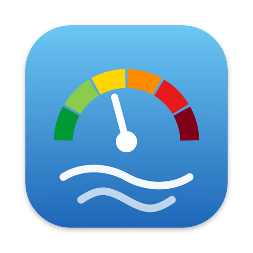
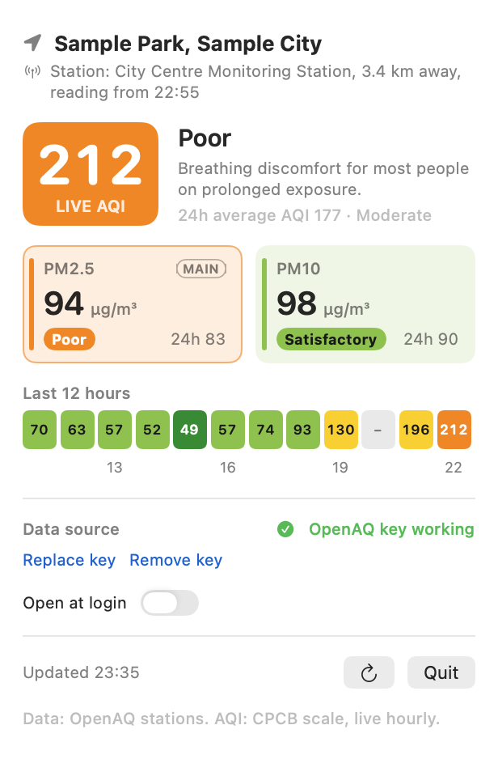
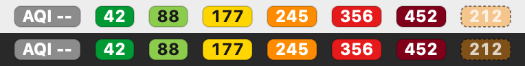

# AQI Bar

A macOS menu bar app that shows the live air quality (Indian CPCB scale), PM2.5 and PM10
for your Mac's current location, with a trend of the last 12 hours. Readings come from the
nearest OpenAQ ground station (CPCB / state pollution board monitors) when you add a free
OpenAQ API key, otherwise from the Open-Meteo model estimate.

Status: complete (step 4 of 4). Ground-station data via OpenAQ with Open-Meteo as fallback,
PM tiles coloured by CPCB band, install script, open at login and offline handling.

The menu bar shows the AQI on a badge in the CPCB category colour; the panel
shows the place, the live AQI with its health meaning, PM2.5 and PM10 tiles, and a colour strip of the last
12 hours (hover a cell for details).





## Install (no developer experience needed)

You need macOS 13 (Ventura) or newer, and Apple's free Command Line Tools. If you've never
installed them, open **Terminal** and run `xcode-select --install`, then click Install.

1. **Build and install.** In Terminal, go to this folder and run the installer:
   ```
   cd ~/Developer/aqi-menubar
   ./install.sh
   ```
   This builds the app, copies it to **/Applications/AQI Bar.app** (or `~/Applications` if
   /Applications isn't writable), closes any running copy and opens the installed one.
2. **Allow location.** The first time, macOS asks whether AQI Bar may use your location.
   Click **Allow**. (If you clicked Don't Allow, open the panel and use
   *Open Location Services Settings* to turn it on.)
3. **Enter your OpenAQ key (optional, recommended).** Click the AQI badge in the menu bar,
   paste your key into **Data source**, and click **Save**. Without a key, AQI Bar shows the
   Open-Meteo model estimate instead of a nearby monitoring station.
4. **Open at login (optional).** Turn on **Open at login** in the panel. If macOS asks, approve
   it in System Settings > General > Login Items.

**Update:** after getting new code, run `./install.sh` again. Your key, location permission
and settings are kept.

**Where things live**
- App: `/Applications/AQI Bar.app`
- OpenAQ key: `~/Library/Application Support/AQIBar/openaq.key` (only your user can read it)
- Cached stations and last location: same folder
- Log (one line per refresh, never the key): `~/Library/Logs/AQIBar.log`

**Uninstall:** turn off *Open at login*, click **Quit** in the panel, then delete
`/Applications/AQI Bar.app`, the folder `~/Library/Application Support/AQIBar` and the file
`~/Library/Logs/AQIBar.log`.

**When you're offline** the panel keeps the last values and says "Offline, showing data from
HH:MM". AQI Bar retries after 1, 2, 4 and 8 minutes, then every 15 minutes, and also refreshes
when the Mac wakes from sleep or the network comes back. Once the data is more than 3 hours
old, the menu bar badge is dimmed with a dashed edge.

## Build only (for development)

```
./build.sh
open "build/AQI Bar.app"
```

## Data sources and the OpenAQ key

- **OpenAQ (ground stations)** is used when a key is saved and a fixed station within 25 km has
  reported PM2.5 or PM10 in the last 3 hours. PM2.5 and PM10 may come from different stations.
  The panel names the station, its distance and the time of the reading (stations can lag).
- **Open-Meteo (model estimate, ~40 km grid)** is the fallback: no key, key not accepted, no
  station nearby, or stale station data. The panel says which and why.

To get a key: register at https://explore.openaq.org/register, then copy the API key from your
account settings. Paste it into the panel's **Data source** field and click **Save**.
The key is stored in `~/Library/Application Support/AQIBar/openaq.key` (file mode 0600), not in
the Keychain: the app is ad-hoc signed, so every rebuild would make the Keychain ask for your
password again. The key is never logged. The chosen stations are cached in `stations.json`
next to it and searched again after you move more than 2 km or every 12 hours.

## How the AQI is calculated

Indian CPCB National AQI from PM2.5 and PM10, using live values: each pollutant's sub-index is
linearly interpolated within the CPCB bands from the current hour's concentration, and the AQI is the
larger sub-index. Each cell of the 12-hour strip is that hour's own AQI. CPCB's official AQI uses
24-hour averages, so the panel also shows the 24h-average AQI and PM averages as secondary text.

## Checks and logs

- `"build/AQI Bar.app/Contents/MacOS/AQIBar" --self-test` runs the AQI calculation checks and exits.
- `./make-icon.sh` regenerates `Resources/AppIcon.icns` and `docs/icon.png` from `Sources/IconRenderer.swift`.
- `"build/AQI Bar.app/Contents/MacOS/AQIBar" --render-preview docs` re-renders the preview images above with sample data.
- `"build/AQI Bar.app/Contents/MacOS/AQIBar" --print-once [LAT,LON]` loads once and prints the source,
  station names, distances, reading times, PM values and AQI (uses the last located coordinate by default).
- Each refresh appends a line to `~/Library/Logs/AQIBar.log`.

## License

MIT, see [LICENSE](LICENSE).
